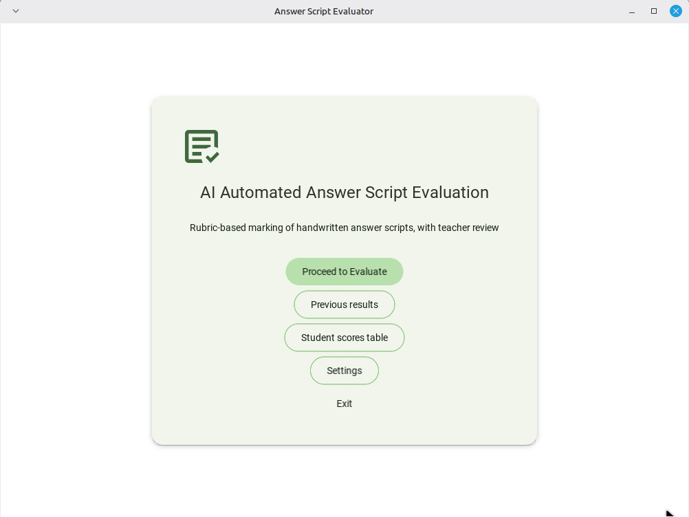
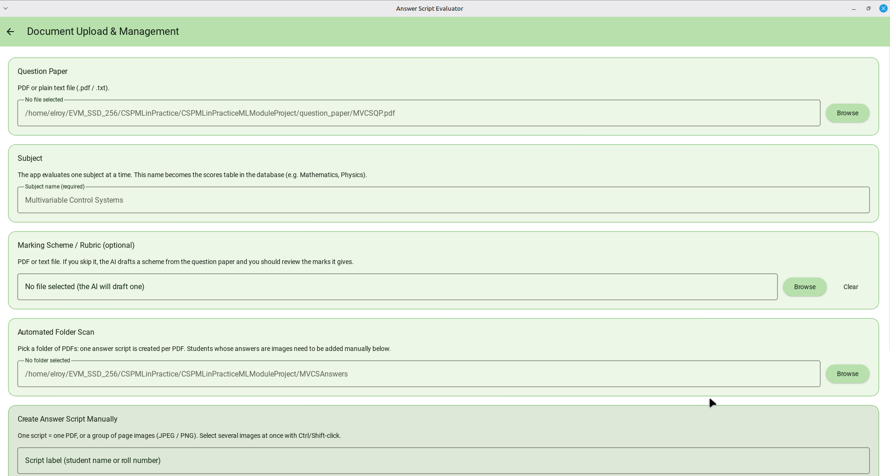
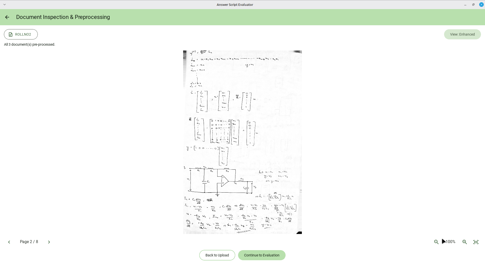
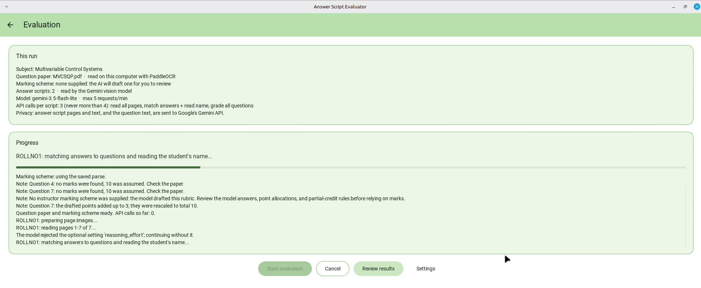
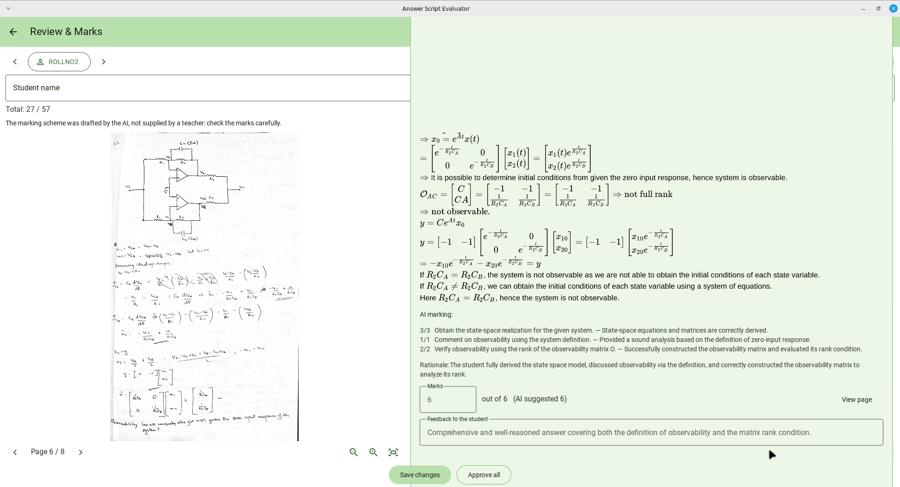
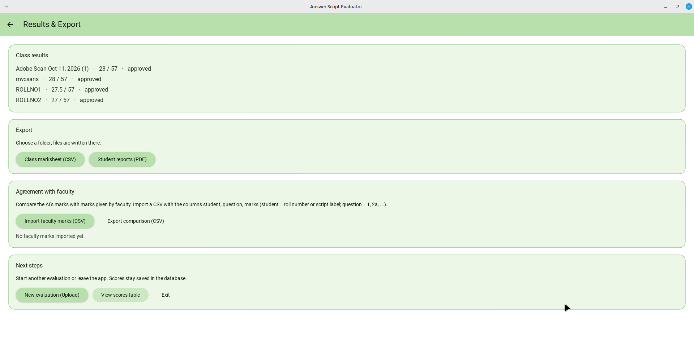
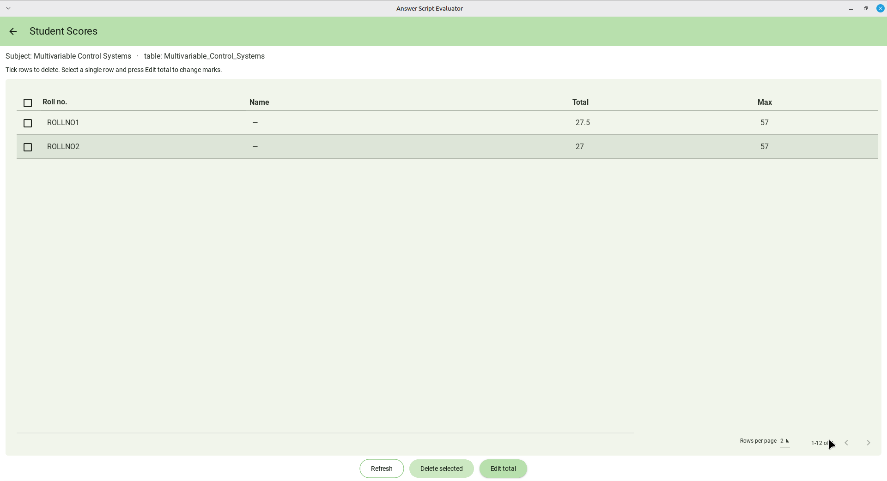
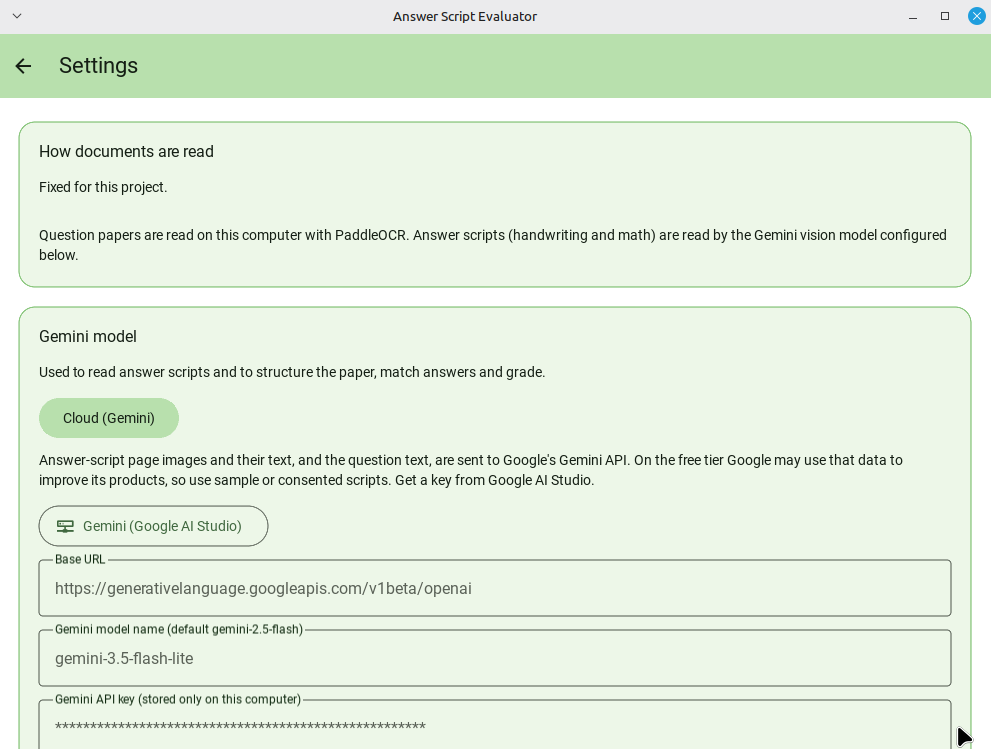
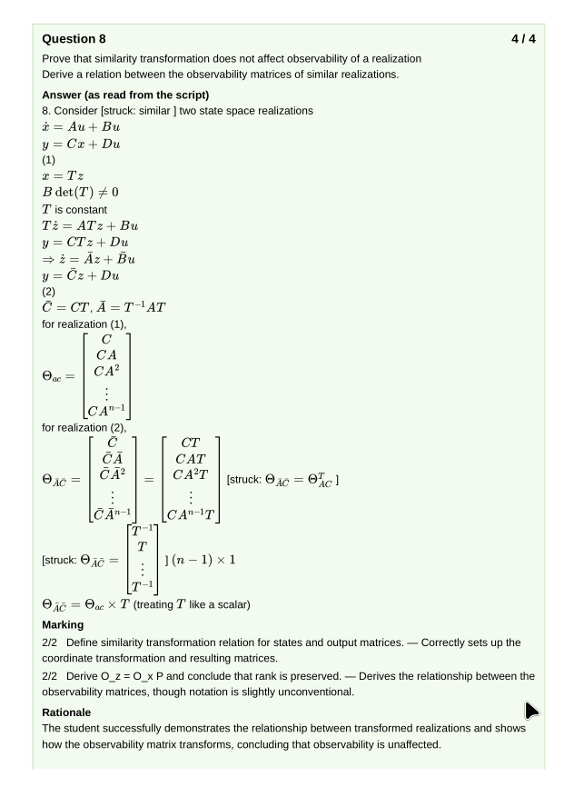

# AI Automated Answer Script Evaluation

A desktop app that marks **handwritten answer scripts** against a question paper and a marking scheme, then lets a teacher review, correct and approve every mark before exporting results.

Built with **Python, Kivy and KivyMD 2.x** (pure Python UI, no KV files). The question paper is read locally with **PaddleOCR**, answer scripts are read and graded by a **vision-language model** (Gemini by default) through an OpenAI-compatible API.

---


<!-- Screenshot: a hero image at the top of the README, e.g. the Review screen or a collage of 2-3 screens. -->

## Features

- **Flexible inputs**: question paper as PDF or `.txt`; optional marking scheme (PDF or text); answer scripts as one PDF or a group of JPEG/PNG page images.
- **Folder scan**: point at a folder of PDFs and one answer script is created per PDF. Image-based scripts can be added manually.
- **Document inspection**: every page is deskewed and pre-processed. Switch between *Enhanced*, *Binarized* and *Original* views, with zoom (buttons or Ctrl + mouse wheel) and pan.
- **Rubric-based evaluation**: question-wise marks, per-point marking, rationale and feedback. If no marking scheme is supplied, the AI drafts one and flags it for careful review.
- **Few API calls**: about 3 per script (never more than 4): read all pages, match answers and read the student's name/roll number, grade all questions in one batch.
- **Rate-limit aware**: configurable requests/min and tokens/min, retries, cancel at any time, and resumable runs (progress is stored in SQLite).
- **Teacher review**: page image beside each question's extracted answer, AI marks and rationale. Edit marks and feedback, flag-for-check warnings, approve per question or all at once.
- **Typeset maths**: LaTeX in answers, rationales and feedback is rendered with KaTeX (live preview while typing feedback).
- **Results and export**: class marksheet (CSV), per-student PDF reports with typeset maths, and a subject-named scores table you can edit or delete from.
- **Agreement with faculty**: import faculty marks (CSV) and get MAE, bias, within-±0.5/±1, exact-match %, Pearson, Spearman and quadratic weighted kappa.

---

## Screenshots

> **TODO:** save each screenshot in `docs/screenshots/` using the file name shown, then delete the note under each image.

### Start

<!-- Screenshot: Start screen with the five buttons (Proceed to Evaluate, Previous results, Student scores table, Settings, Exit). -->

### Upload

<!-- Screenshot: Upload screen with a question paper chosen, a subject entered, and a few answer scripts listed under "Answer Script Objects". -->

### Inspection

<!-- Screenshot: Inspection screen showing a handwritten page in the "Enhanced" view, with the zoom controls visible. -->

### Evaluation

<!-- Screenshot: Evaluation screen mid-run, with the progress bar part-filled and the log showing a few lines. -->

### Review

<!-- Screenshot: Review screen in the wide layout, page image on the left and question cards on the right, ideally with typeset maths and a "Please check" warning. -->

### Results

<!-- Screenshot: Results screen showing the class table and the "Agreement with faculty" metrics after importing a CSV. -->

### Scores table

<!-- Screenshot: Scores screen with the data table and a couple of rows ticked. -->

### Settings

<!-- Screenshot: Settings screen. Blur or crop out your API key first. -->

### Sample PDF report

<!-- Screenshot: first page of an exported student PDF report with rendered maths. -->

---

## Workflow

```
Start → Upload → Inspection → Evaluation → Review → Results / Scores
```

| Screen | What it does |
|---|---|
| **Start** | Entry point: new evaluation, previous results, scores table, settings |
| **Upload** | Question paper, subject name, optional rubric, folder scan, manual scripts |
| **Inspection** | Pre-processes all documents; view any page enhanced / binarized / original |
| **Evaluation** | Runs the pipeline in a background thread with live progress, cancel and resume |
| **Review** | Teacher checks and corrects marks, edits feedback, approves |
| **Results** | Marksheet CSV, PDF reports, faculty-agreement metrics |
| **Scores** | Subject scores table: delete rows or manually edit a total |
| **Settings** | Model, API key, rate limits, reasoning effort |

### Pipeline (per script)

```
Pre-process pages → Transcribe → Read name / roll no. → Segment & match answers → Grade against rubric → Store
```

The model judges each answer; plain code validates and sums the marks. Every stage's output is saved in the database so an interrupted run can continue where it stopped.

---

## Project structure

```
.
├── main.py                  # App entry point (screen manager, theme)
├── prompts.md               # Model prompts, kept outside the Python source
├── .env                     # Your API key / model (not committed)
├── .env.example             # Template for .env
├── docs/screenshots/        # README images (see Screenshots)
├── core/                    # No Kivy imports: runs from a terminal or worker thread
│   ├── ocr_engine.py        # Page pre-processing, LLM client, transcription backends
│   ├── parser.py            # Question paper, rubric and answer-segmentation parsing
│   ├── evaluator.py         # Grading, SQLite store, pipeline, reports, agreement metrics
│   └── prompts.py           # Loads prompts from prompts.md
└── ui/
    ├── widgets.py           # Shared theme and helpers (cards, buttons, app bar, file chooser)
    ├── start_screen.py
    ├── upload_screen.py
    ├── inspection_screen.py # Includes the zoomable image viewer
    ├── evaluation_screen.py
    ├── review_screen.py
    ├── results_screen.py
    ├── scores_screen.py
    ├── settings_screen.py
    ├── math_render.py       # KaTeX + headless Chromium (Playwright) renderer
    ├── math_view.py         # Label widget that typesets its LaTeX
    ├── report_html.py       # HTML → PDF student reports with typeset maths
    └── web/                 # fragment.html, render.js, katex/ (downloaded on first use)
```

---

## Installation

**Requirements:** Python 3.10+ and a Gemini API key (the free tier works).

```bash
# 1. (optional) create a virtual environment
python -m venv .venv
source .venv/bin/activate        # Windows: .venv\Scripts\activate

# 2. core dependencies
pip install kivy kivymd numpy opencv-python-headless PyMuPDF
pip install paddleocr paddlepaddle

# 3. typeset maths and PDF reports (recommended)
pip install playwright
playwright install chromium
```

KaTeX is downloaded automatically the first time it is needed. To fetch it up front:

```bash
python -m ui.math_render
```

If Playwright or Chromium is missing, the app still works: maths is shown as plain text and reports fall back to a text-only PDF.

---

## Configuration

Copy `.env.example` to `.env` next to `main.py` and fill it in:

```env
GEMINI_API_KEY=your-key-here     # GOOGLE_API_KEY also works
GEMINI_MODEL=gemini-2.5-flash    # any Gemini vision-capable model name
GEMINI_RPM=5                     # optional: max requests per minute
GEMINI_TPM=0                     # optional: max tokens per minute (0 = no limit)
```

Values in `.env` take priority over the Settings screen, so your key survives restarts. Everything else (reasoning effort for reading and grading, etc.) is in the **Settings** screen.

> The default of 5 requests/minute stays under the Gemini free-tier limit. Raise it if your quota allows.

---

## Usage

```bash
python main.py
```

1. **Upload**: choose the question paper, enter the **subject name** (it names the scores table), optionally add a marking scheme, then add answer scripts (folder scan or manual).
2. **Inspection**: check that pages look right, then continue.
3. **Evaluation**: press **Start evaluation**. You can **Cancel** at any time and **Resume** later.
4. **Review**: for each student, confirm the name and roll number, check flagged answers, adjust marks and feedback, and approve.
5. **Results**: export the marksheet and PDF reports, or import faculty marks to measure agreement.

### Faculty-marks CSV format

```csv
student,question,marks
ROLLNO1,1,4
ROLLNO2,2a,2.5
```

`student` is a roll number or script label; `question` is the question id (`1`, `2a`, ...).

---

## Privacy

Answer-script page images, the transcribed text and the question text are **sent to Google's Gemini API** for reading and grading. The question paper itself is read locally with PaddleOCR. Evaluation data (database and page images) is stored in the app's user-data folder on your machine. Only use real student scripts if you have permission to do so.

---

## Troubleshooting

| Problem | Fix |
|---|---|
| "Set your Gemini API key" | Add `GEMINI_API_KEY` to `.env` next to `main.py`, or enter it in Settings |
| Rate-limit / quota errors | Lower `GEMINI_RPM`; the run pauses and can be resumed |
| "PaddleOCR is required..." | `pip install paddleocr paddlepaddle` |
| `opencv` or `fitz` not installed | `pip install opencv-python-headless PyMuPDF` |
| Maths shows as raw LaTeX | Install Playwright and Chromium (see Installation) |
| `FBO Initialization failed` | Already handled in `ui/widgets.py`; make sure it is imported before other screens |

---

## Tech stack

Kivy · KivyMD 2.x · PaddleOCR · OpenCV · PyMuPDF · Gemini (OpenAI-compatible endpoint) · SQLite · KaTeX · Playwright (Chromium)
